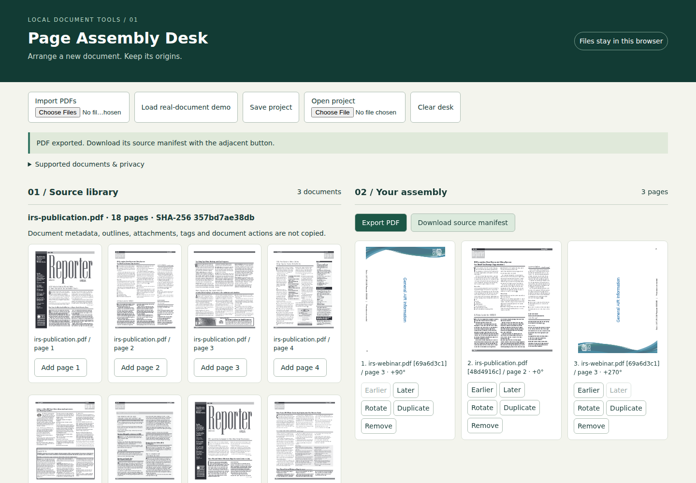

# PDF Page Assembly Desk

A local visual workbench for selecting, reordering, rotating, duplicating and combining pages. Each exported page has a source filename, page number and SHA-256 reference in a downloadable manifest. Source PDFs are never overwritten.

## Launch

Install Node.js 22 or newer and npm, then run:

```sh
./launch.sh
```

Open **http://127.0.0.1:4173**. The first launch needs internet to install pinned npm packages; after installation `npm start` works offline. The server binds only to loopback and serves application assets and bundled examples. PDFs you import remain in browser memory and IndexedDB, with no upload endpoint or external runtime requests. Stop with Ctrl-C. Use a modern desktop browser; Chromium is the tested browser.

## Assemble a document

1. Import one or more PDFs, or choose **Load real-document demo** for the bundled historical IRS publication and landscape webinar.
2. Inspect page thumbnails and use **Add page**. In Your assembly, use **Earlier**, **Later**, **Rotate**, **Duplicate**, and **Remove**. Rotation is clockwise in quarter turns, added to the original rotation.
3. Reload to recover the desk in this browser. **Save project** downloads a portable JSON plan. **Open project** restores it; re-import the exact original PDFs when marked missing. Hashes, not filenames, establish source identity. A changed file with the same name cannot substitute for the original.
4. **Export PDF**, then **Download source manifest**. Keep both files together. The manifest hashes the exported PDF and accounts for each output page, including duplicates.

**Clear desk** deletes the app's stored originals and plan. Browser storage may be cleared or evicted by the browser; keep exported plans and originals as your durable backup. Project JSON does not embed PDFs. Source names and hashes are included in projects and manifests, so treat those files as potentially sensitive.

## Visible real-document example



Open [sample PDF](demo/assembly.pdf), [source manifest](demo/assembly.manifest.json), and [portable project](demo/assembly.project.json). To reproduce the sample visually, load the real-document demo and open the sample project. It orders webinar page 3 (+90°), publication page 2 (0°), webinar page 3 again (+270°), and publication page 1 (+180°). These are historical layout examples, not current tax guidance.

The browser exercise also saves its actual downloaded [PDF](demo/browser.pdf), [manifest](demo/browser.manifest.json), and [plan](demo/browser.project.json).

## Supported behavior and limits

- Maximum 10 MiB per PDF, 40 MiB total imported bytes, 100 source documents, 200 pages per source and 300 output pages. Thumbnails are rendered sequentially; large documents take time. Files are parsed in browser memory; the limits are conservative product bounds, not memory guarantees.
- Static page content, MediaBox, CropBox and other copied page boxes are retained. Existing page rotation is combined with your added rotation. Cropped areas remain in the PDF; this is not redaction. No rasterization is used for export.
- **Links are flagged and omitted** from export. **Forms and non-link annotations are rejected**, including comments and signature widgets; flatten these in a trusted editor before importing. Encrypted PDFs, custom page UserUnit values and non-quarter-turn rotations are unsupported. Invalid PDFs show errors.
- Document-level outlines, metadata, attachments, tags and actions are not copied. New producer/creator metadata is set. Reading order, accessibility tags, signatures, color profiles, PDF/A conformance and print-production behavior are not guaranteed. No OCR, form editing, semantic sanitization, undo, or collaborative/multi-tab editing. Use one tab per desk.
- This is a page assembly tool, not a security sanitizer. Only import documents you trust. Removing links is not a promise that all potentially active page content has been sanitized.

## Verification

```sh
npm ci
npm test
npm run verify
PLAYWRIGHT_BROWSERS_PATH=/tmp/pdf-desk-browsers npx playwright install chromium
PLAYWRIGHT_BROWSERS_PATH=/tmp/pdf-desk-browsers npm run test:browser
```

Linux browser testing requires Chromium's normal system libraries. The browser test owns a temporary loopback server on port 4179 and shuts it down. All test fixtures are public documents or clearly labeled generated controls.

`npm run verify` creates the sample exports and uses **MuPDF**, independent of both **PDF.js** preview and **pdf-lib** export, to reopen them. For every page it checks expected source identity/order, duplicates, inherited page boxes, rotation, dimensions, extracted text and raster pixels against the original with the intended rotation independently applied through MuPDF. The pixel threshold is mean absolute RGB difference <0.15 on the 0–255 scale. Generated controls cover crop offsets, mixed page sizes, duplicate selections, and existing 90°/270° rotations. Results are in [verification.json](results/verification.json).

The Playwright test imports the actual PDFs through file inputs, performs all page operations, reloads, exports/imports a plan, tests missing and changed originals, recovers with correct originals, downloads PDF and manifest, and reopens the downloaded PDF with MuPDF. It also checks switching projects while retaining a source library. Evidence is in [browser.json](results/browser.json). These bounded checks do not establish compatibility with arbitrary PDFs or every browser.

## Sources and dependency choices

Prior art was inspected before implementation: [PDF Arranger's manual](https://github.com/pdfarranger/pdfarranger/wiki/User-Manual) documents mature visual merge/reorder/rotate workflows. This project makes no novelty claim; its narrower scope emphasizes browser-local recovery and explicit per-page provenance.

[PDF.js examples](https://mozilla.github.io/pdf.js/examples/) informed page viewport/canvas rendering and worker setup. [pdf-lib's PDFDocument API](https://pdf-lib.js.org/docs/api/classes/pdfdocument) provides page copying without rasterization; [its PDFPage API](https://pdf-lib.js.org/docs/api/classes/pdfpage) documents rotation and page boxes. [MuPDF's JavaScript API](https://mupdf.readthedocs.io/en/latest/reference/javascript/) supplies the independent reader and renderer for tests. Dependencies are pinned in package-lock.json. PDF.js is Apache-2.0; pdf-lib is MIT; MuPDF is AGPL-3.0 and is used as a development verification dependency, not served by the application.

[fixtures/sources.json](fixtures/sources.json) records original URLs, SHA-256 hashes and public-domain evidence for the IRS-authored documents. Publication 1693 explicitly states its public-domain status; the official IRS webinar is also a U.S. government work. See the [U.S. Copyright Office's federal-work explanation](https://www.copyright.gov/history/copyright-exhibit/lifecycle/). Government logos do not imply endorsement. Reacquire exact source bytes with:

```sh
node scripts/acquire.mjs
```

Acquisition refuses upstream hash changes rather than silently replacing the fixtures. `fixtures/controls.pdf` is generated by the verifier, not a real-world input.
