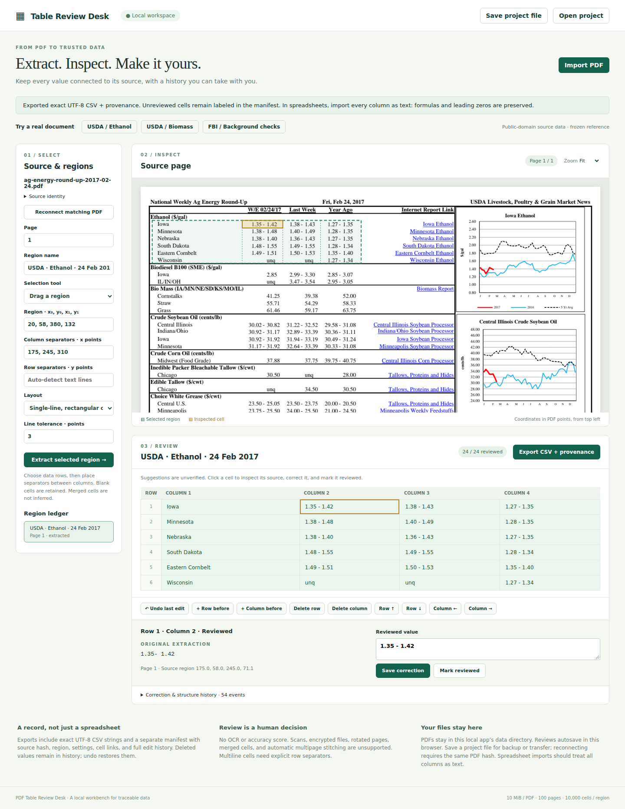

# PDF Table Review Desk

A local browser workbench for turning text-based PDF tables into **reviewed,
source-linked CSV**, with immutable extraction suggestions and a portable edit
history. No account, hosted service, OCR, or paid inference is needed.

## Launch

With Python 3.10+ and its `venv` module installed:

```sh
./launch.sh
```

Open **http://127.0.0.1:8765**. First launch installs pinned dependencies from PyPI;
subsequent launches work offline. The server listens only on loopback. Stop it
with Ctrl-C. Set `PORT=8766` to use another port. If Python reports that ensurepip
is missing, install your operating system's Python venv package and rerun.



## Try a real document

1. Click **USDA / Ethanol**, then **Extract selected region**. This loads a real
   2017 USDA report and a recorded region, not synthetic data or a prefilled answer.
2. Click row 1, column 2. The amber rectangle locates the cell on the PDF. Original
   extraction reads `1.35- 1.42`; the visible reference is `1.35 - 1.42`.
3. Enter the corrected string, **Save correction**, then **Mark reviewed**.
   Corrections do not automatically count as review. **Undo last edit** restores
   the prior state. Reload to recover your review.
4. **Export CSV + provenance** downloads a ZIP containing `table.csv` and the
   separate `provenance.json`. Every cell keeps its source box and review flag.
5. Try **USDA / Biomass** and **FBI / Background checks**. The FBI example covers
   all 55 jurisdictions plus totals, restricted to the first four columns.

[Sample CSVs and manifests](examples/) were produced through the actual browser
workflow. They include the 19 effective corrections found against the visually
checked reference. These are bounded table selections, not a claim of full-page
extraction accuracy. See [fixture provenance and reference errata](fixtures/README.md)
and [measured results](results/README.md).

## Work with your PDF

- **Import PDF**. Choose a page, drag a rectangle around data rows, and use
  **Click column separators** to place vertical boundaries in the gaps. You can
  also type exact PDF coordinates. With no separators the region is one column.
- Single-line mode detects text rows. For multiline cells, select **Multiline**
  and place horizontal separators between logical rows; newlines remain inside
  the CSV cell. Select headers separately or include them deliberately: the app
  never invents a CSV header row.
- Inspect each cell, save any correction, then mark reviewed. Yellow cells are
  suggestions; green cells are explicitly reviewed. No accuracy score is inferred.
- Select a cell before inserting, deleting, or moving its row/column. Insertions
  go before the selection. Deleted values remain in history. Undo also reverses
  structural edits. Added cells have no automatic source link.
- The region ledger includes extracted, unsupported, and failed requests. Retrying
  creates a new region and keeps the old attempt. Exports list all region statuses.

## Recovery and transfer

Reviews autosave in this browser's local storage, separately for each PDF hash.
Selecting the same PDF recovers its project. **Save project file** makes a portable
JSON backup; **Open project** restores it. PDFs are stored locally in `.data/`
(or `PDFDESK_DATA`); PDF bytes are not embedded in project files.

On another machine, open the project JSON, then **Reconnect matching PDF**. A
SHA-256 match is mandatory; a same-named but different PDF is rejected. Import
and export regenerate original suggestions to check source/settings consistency.
Use the pinned dependency versions for recovery; an extraction-version mismatch
must be resolved by retaining that environment or creating a new region.

Browser storage can be cleared or fill up. The app reports failed autosaves;
keep JSON backups. A review project is an editable record, not a tamper-proof
signature or proof that a particular person reviewed the cells. Do not use
multiple tabs to edit the same project concurrently.

## CSV behavior and limits

CSV is UTF-8, comma-separated, with CRLF records and standard quoting of commas,
quotes, and embedded newlines. Every value stays a string: `001`, blank values,
Unicode, and formula-looking text are preserved. **CSV cannot force spreadsheet
cell types.** Import every column as text to preserve leading zeros and prevent
spreadsheet formula evaluation. The app does not prepend apostrophes or silently
change data to sanitize formulas. The manifest records the CSV SHA-256, source
identity, page/region, settings, original suggestions, review flags, and edits.

- Maximum PDF: 10 MiB, 100 pages, 2000 points per page dimension.
- Maximum region: 10,000 cells; maximum project: 100 regions. Undo history is
  bounded to 500,000 retained cell states per region. Cell edits retain one
  cell; structural edits retain a grid, so frequent large-table restructuring
  reaches this limit sooner. Project JSON imports
  are limited to 10 MiB. Use small table selections for responsive review.
- Scanned/image-only regions, encrypted PDFs (even empty-password encryption),
  rotated pages/text, nonstandard cropped/offset/scaled page boxes, merged cells,
  and automatic multipage stitching are unsupported. Normalize page boxes in a
  separate copy before import so source and extraction coordinates agree.
- Merged-cell semantics cannot always be detected from geometry. Declare a merged
  layout to record it as unsupported, or select an unmerged subtable. Separators
  crossing text are rejected. No OCR is performed.
- Text row grouping and spacing are heuristic. Inspect the source, especially
  superscripts, dense tables, multiline content, and partial selections.
- This is a single-user local application. No server authentication or production
  deployment is provided. Do not expose it through a public reverse proxy.

## Reproduce verification

```sh
.venv/bin/python -m pip install -r requirements-dev.txt
PLAYWRIGHT_BROWSERS_PATH=/tmp/pdfdesk-browsers .venv/bin/playwright install chromium
.venv/bin/python -m pytest -q tests/test_core.py
PLAYWRIGHT_BROWSERS_PATH=/tmp/pdfdesk-browsers .venv/bin/python -m pytest -q tests/test_browser_recovery.py
PLAYWRIGHT_BROWSERS_PATH=/tmp/pdfdesk-browsers .venv/bin/python scripts/browser_check.py --output /tmp/pdfdesk-exports
.venv/bin/python scripts/verify_exports.py --directory /tmp/pdfdesk-exports
.venv/bin/python scripts/verify_exports.py
```

The browser script launches an isolated local server and temporary data directory;
it imports real PDFs, selects a region by dragging, corrects/reviews every reference
cell, exercises structural edits/undo, reload recovery, project export/import,
source mismatch rejection, and CSV download. The independent verifier imports no
application code: it uses Python's CSV reader and a separate event replay to check
all cells, ordering, corrections, source hashes, and output hashes. Synthetic
edge-case controls in `tests/test_core.py` are explicitly labeled by their helper
name and cover unsupported formats, multiline cells, and exact-string CSV behavior.

[Design and existing work](docs/design.md) explains dependency choices and scope.
This project builds on existing extraction approaches and claims no algorithmic
novelty. Private remote publication/verification is handled separately; this
checkout alone does not establish a verified remote implementation commit.
