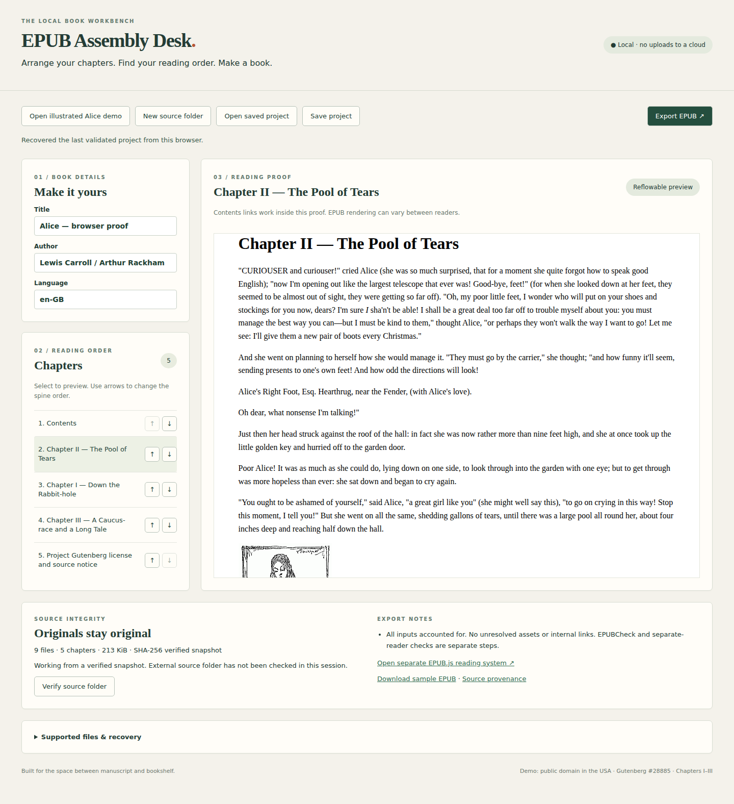

# EPUB Assembly Desk

A local browser workbench for arranging Markdown chapters and exporting an EPUB 3 book with images and linked navigation. The included real-input demo is a reflowable **chapters I–III excerpt**, not the full *Alice’s Adventures in Wonderland*.

## Launch

With Node.js 20+ and npm installed:

```sh
./launch.sh
```

Open **http://127.0.0.1:4173**. The first launch installs pinned npm dependencies; later launches work offline. To change port: `PORT=4180 ./launch.sh`. Use the printed `127.0.0.1` address, not `localhost`. Stop with Ctrl+C. No account, hosted service or upload to a third party is needed. This is a local single-user app.

1. Choose **Open illustrated Alice demo**, or **New source folder** containing your `.md` chapters and image assets. The demo folder is `demo/manuscript`.
2. Edit title, author and BCP 47 language; leave each field to apply it. Select chapters to preview; use their arrows to change the reading order. The preview’s contents links are clickable.
3. **Save project** downloads original source bytes, SHA-256 hashes, order and metadata as JSON. **Open saved project** restores it. Successful edits also recover on browser reload through IndexedDB.
4. **Verify source folder** compares external files to the snapshot and reports changed, added or missing files. It never replaces content. Import a new source folder to adopt external edits; that starts a new book with default metadata and alphabetical order.
5. **Export EPUB**, then **Open separate EPUB.js reading system** and select the exported file. The reading system consumes the archive, not workbench preview HTML. Test your target reader before distributing a book.

The app never edits source files on disk. Browser storage is origin-specific and can be cleared or denied; portable project downloads are your backup. Invalid imports preserve the current project. Unsaved invalid edits disable export and leave the last valid recovery snapshot intact. Reordering changes the EPUB spine and generated TOC; it does not rewrite an author’s handwritten contents list.



[Download the sample EPUB](demo/alice.epub) · [Portable demo project](demo/alice.project.json) · [Separate reader evidence](results/reader.png) · [Rendered illustration](results/reader-image.png)

## Markdown and resources

The input is UTF-8 CommonMark as parsed by markdown-it 14.1.0, with explicit heading IDs added:

```md
# Chapter title {#chapter-one}

A paragraph with *emphasis*, **strong text**, and `code`.


[Next chapter](chapter-2.md#another-heading)
```

Supported: ATX/setext headings, paragraphs, emphasis, lists, blockquotes, thematic breaks, fenced/indented code, inline code, images, CommonMark links and reference definitions. Heading IDs derive from lowercased Unicode letters/numbers, spaces become hyphens, punctuation is removed. Duplicate generated headings gain `-2`, `-3`, etc. Explicit IDs begin with an ASCII letter and contain letters, digits, `_`, `.`, `:`, or `-`; duplicate explicit IDs fail. Relative chapter links resolve against each chapter’s directory and must point to a known chapter/heading. URL-encoded fragments are supported. Image references must resolve locally.

Raw HTML, GFM tables, footnotes, strikethrough, templates and recognized display-math/wiki extensions and YAML front matter are rejected. Possible task-list syntax, inline math and unresolved link-like syntax are retained literally with an explicit export warning. This is not Pandoc or arbitrary Markdown-extension support. Code blocks remain literal. Inspect the preview for constructs outside the documented subset. HTTP(S)/mailto links are retained and flagged as external; remote images, other URL schemes, query strings on local links, SVG, CSS, fonts, scripts, and other imported file types are rejected. Unsupported/unresolved assets and missing headings stop export. Unused image files are included and explicitly flagged. All Markdown files must appear exactly once in the reading order.

Import only the manuscript folder, not a repository with README/license/config files mixed in. Maximum 200 files, 8 MiB per file, 20 MiB total. Paths must be relative without traversal components, backslashes, `%`, `#`, `?`, `:` or control characters. PNG/JPEG/GIF headers are checked; fully decoding images is a browser/reader check. Browser recovery needs enough IndexedDB quota. ZIP expansion of arbitrary external EPUBs is not bounded by this app: the bundled reader is for trusted exports, not an untrusted-library importer.

## Real manuscript and provenance

[Project Gutenberg #28885](https://www.gutenberg.org/ebooks/28885) identifies Lewis Carroll’s text and Arthur Rackham’s illustrations as public domain in the USA, with a last-update date of January 5, 2021. The retained [provenance manifest](demo/provenance.json) records exact source URLs, byte hashes, licensing evidence, conversion, source-derived text expectations, image references and chapter links. Original HTML and catalog bytes live in `demo/source`; the Gutenberg license is also included in the EPUB. Public-domain status outside the USA is not assessed here.

The conversion selects three narrative chapters and their contents destinations, restores drop-cap letters as text, removes running page numbers/side notes, and flattens print layout/CSS. Four inline illustrations remain byte-identical. Background decorations, print geometry and verse shaping are not preserved. This is an explicitly converted excerpt, not a facsimile. Its source byte revision is identified by hashes because the upstream URL is mutable.

```sh
node scripts/acquire.mjs             # reproduce from retained source, compare manifest
node scripts/build-demo.mjs          # regenerate portable project and sample EPUB
python3 scripts/verify-epub.py        # separate ZIP/XML/source oracle
```

`node scripts/acquire.mjs --download` reacquires public upstream files and records a new manifest; use it intentionally when updating the fixture. Upstream changes can alter the snapshot. `--record` records conversion changes against retained source bytes. Neither command touches user manuscripts. Review fixture updates before accepting new hashes.

## Verification

```sh
npm test
PLAYWRIGHT_BROWSERS_PATH=/tmp/epub-browsers npx playwright install chromium
PLAYWRIGHT_BROWSERS_PATH=/tmp/epub-browsers npm run test:browser
python3 scripts/verify-epub.py /tmp/epub-browser-artifacts/book.epub /tmp/epub-browser-artifacts/book.project.json
python3 scripts/epubcheck.py
```

Browser checks start a temporary server on port 4174. They exercise real folder import, editing, ordering, preview, reload, project download/reimport, corrupt-project rejection, source-change detection, and export. They then open the downloaded EPUB in **EPUB.js 0.3.93**, check contents/previous navigation and an original cross-chapter link, and check image decoding. Screenshots and findings are in `results/`; downloaded files are in `/tmp/epub-browser-artifacts`.

The independent Python oracle imports no application modules: it parses ZIP/XML and compares all section text to the pre-Markdown source-DOM manifest, image bytes/alt text to source, every original link destination, all generated link targets, spine/TOC order and metadata. Core tests separately label controls for duplicate headings, Unicode, missing assets and cross-chapter links. `results/epubcheck.json` retains the actual EPUBCheck 5.3.0 findings for the sample. The checker helper requires Java 17+ (`JAVA=/path/to/java` if needed), downloads the official release to a temporary cache, and verifies its pinned archive SHA-256. It is not required to launch the app.

### Limits of the evidence

The real input has five sections, four illustrations and three original contents links. This is a useful small book workflow, not validation at maximum input size. Linux Chromium is the tested browser. EPUB.js is an independent reading engine but shares Chromium’s HTML rendering engine with the preview; Apple Books, Kobo, Kindle conversion, Calibre and other reading systems have not been tested. EPUBCheck conformance does not establish identical rendering or accessibility compliance.

The UI has labels, keyboard buttons and status announcements; image alternative text is preserved. There has been no screen-reader or formal accessibility audit. Reading order, alt-text quality, poetry layout and semantic heading hierarchy require editorial review. No accessibility certification, page-list mapping, cover designation, fixed layout, media overlays or embedded fonts is provided. EPUB.js has older transitive dependencies and is isolated to the trusted-export reader page. Private-repository verification/checkpointing is handled outside the app by its controller.

### Existing work

[Pandoc](https://www.pandoc.org/epub.html) already converts manuscripts to EPUB. [EPUBCheck](https://www.w3.org/publishing/epubcheck/) checks conformance. [EPUB.js](https://github.com/futurepress/epub.js) supplies the separate reading engine. This work adds a small local arrangement and recovery workflow; it does not claim a new format or conversion technique. Dependency versions and integrity hashes are locked in `package-lock.json`.
