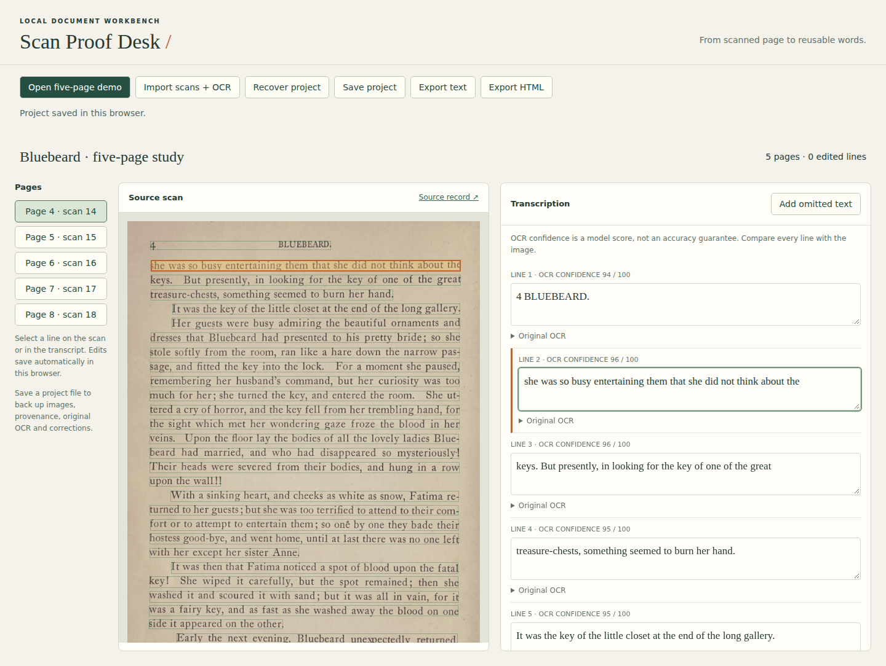

# Scan Proof Desk

A local workbench for correcting scanned English print while keeping each line linked to its source. CPU OCR runs on your computer through Tesseract.js. No account or paid API is required.

## Launch

Install Node.js 22 or newer, then run this one command from the repository:

```sh
npm ci && npm start
```

Open **http://127.0.0.1:4173** and choose **Open five-page demo**. The bundled real scans and OCR work without internet after dependency installation. Importing new scans downloads the English model on first use into `.cache/`; subsequent OCR uses that cache. The server binds to loopback only. Scans are sent to that local server, not an OCR service.



1. Open the demo, or use **Import scans + OCR** for JPEG/PNG files (selection order is page order). Import creates a new workspace; export your current project first. OCR can take a minute for five pages.
2. Select a text rectangle on the scan. Edit the corresponding line on the right. **Original OCR** remains available, with a restore button. OCR confidence is a model score, not an accuracy guarantee.
3. Edits persist in IndexedDB for this browser and origin. **Save project** downloads a portable JSON containing scans, provenance, original OCR, and edits. **Recover project** restores it in a fresh browser. Browser-data deletion removes local edits; keep backups.
4. **Export text** gives UTF-8 with page labels. **Export HTML** gives a standalone file with embedded scans and links from every line to its source region. Open that file directly without running the server.
5. If OCR missed text, select the preceding line and choose **Add omitted text** (or append with no selection). Added text links to the whole page, since its exact bounding box is unknown. Clear a line to suppress spurious OCR while preserving its original.

## Real document and reproduction

The demo contains scans 14–18 (printed pages 4–8) of *The Story of Bluebeard, and other stories* (1905), from the [Library of Congress item record](https://www.loc.gov/item/05021568/). The source states that these books are public domain and free to use and reuse. Credit: Library of Congress. The historical story includes violence.

`demo/provenance.json` records the source record, rights statement, rights-evidence URL, retrieval date, individual image URLs, and SHA-256 hashes. Images are the supplied 50% JPEG derivatives, without further processing. Original uncorrected CPU OCR is stored separately per page in `demo/page-*.json`. Neither library OCR nor synthetic text was used to generate it.

```sh
node scripts/fetch-scans.js  # requires curl + internet; refuses changed source hashes
npm run demo:ocr            # CPU English LSTM, automatic page segmentation (PSM 3)
```

Dependencies are pinned by the lockfile. The English model is the Tesseract.js default model; its cached hash is recorded in `demo/engine.json`. OCR results can vary with engine/model/platform changes. The committed originals are the baseline for the sample measurement.

This is a small workflow built on existing OCR, not a claim of novel recognition. [Tesseract.js](https://github.com/naptha/tesseract.js) provides CPU recognition and bounding boxes; [Scribe OCR](https://github.com/scribeocr/scribeocr) is an existing broader document OCR application.

## Verification and sample measurement

```sh
npm test
PLAYWRIGHT_BROWSERS_PATH=/tmp/scan-proof-browsers npx playwright install chromium
PLAYWRIGHT_BROWSERS_PATH=/tmp/scan-proof-browsers npm run test:browser
npm run measure
```

The Chromium workflow imports all five real scans through the UI and performs CPU OCR, selects a source region, edits text, reloads, exports and recovers into a fresh browser context, and checks text and offline HTML exports. It checks that one unique correction appears once, all other region records are preserved, and all five images are embedded. A separate browser case applies the real sample correction and saves its actual export to `demo/corrected-sample.json`.

`demo/sample.json` fixes five visually checked lines from scan 14. The implementing agent transcribed these from the image; a second reviewing agent independently checked them against the image, but there is no human annotation. Selection happened after inspecting OCR and is not representative. `npm run measure` computes Unicode-codepoint character error rate and whitespace-token word error rate using Levenshtein distance, collapsing whitespace only. It writes exact counts and rates to `results/measurement.json`. Corrected text is evaluated against the same reference used for proofreading, so zero sample error is not evidence of general accuracy. No stochastic sampling or seed is used.

## Limits

- Printed English only in this release; other languages need different models. Handwriting is not validated.
- Reading order is Tesseract's inferred order. Columns, headers, illustrations and tables can be misplaced or recognized as gibberish; there is no table structure export or drag-to-reorder interface. Edit line text or recover/edit a project file when necessary.
- Omitted text is not detected automatically. Compare the entire scan; the confidence score cannot reveal missing regions. Manual additions link to the full page.
- Exports preserve line breaks and printed hyphenation, not original typography or paragraph layout. Blank corrections still produce blank lines.
- JPEG/PNG only; no PDF import. Up to 50 pages, 8 MiB and 25 megapixels per imported image; project recovery is capped at 64 MiB. Large projects can exceed browser storage/memory; this milestone is for small documents.
- One current workspace per browser origin. Use one editing tab; simultaneous tabs can overwrite each other's saves. There is no multi-user synchronization or version history.
- User imports retain filenames and hashes, but their rights/source must be documented by the user. Only the bundled demo has verified source provenance.
